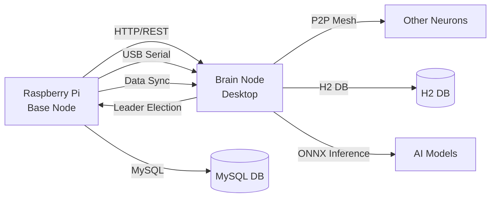
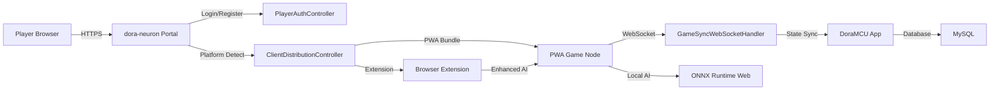

# DoraMCU

**DoraMCU** is a multi-module Spring Boot application for tabletop role-playing game simulation, AI-powered gameplay, and device management. It supports multiple game systems including Traveller, Star Trek 4X, Babylon 5, Earth 2026, and D&D 5E.

[](https://github.com/YoungerIndustries/DoraMCU-26/actions/workflows/ci.yml)
[](https://github.com/YoungerIndustries/DoraMCU-26/actions/workflows/release.yml)
[](https://www.oracle.com/java/technologies/javase/jdk27-archive-downloads.html)
[](https://spring.io/projects/spring-boot)
[]()
[](https://dependabot.com/)
[](CHANGELOG.md)

## Features

- **Multi-Game Support**: Traveller, Star Trek 4X, Babylon 5, Earth 2026, D&D 5E, and more
- **AI-Powered Gameplay**: Deep learning-based AI commanders with configurable difficulty levels
- **Hex Galaxy System**: Procedurally generated galaxies with themed templates (Traveller, Star Trek, Babylon 5)
- **Neuron Federation**: Distributed AI coordination with CDC (Change Data Capture) and snapshot support
- **Device Management**: IoT device monitoring and control via REST APIs
- **Real-Time Communication**: WebSocket support for live game sessions
- **Monitoring & Observability**: Prometheus metrics, Grafana dashboards, health endpoints
- **Container Deployment**: Docker Compose and Kubernetes (Kustomize) configurations

## Architecture

```
DoraMCU/
├── src/main/java/com/yisy/modules/doramcu/
│   ├── traveller/        # Traveller RPG rules and gameplay
│   ├── star_trek_4x/     # Star Trek 4X strategy game
│   ├── babylon5/         # Babylon 5 universe data and galaxy integration
│   ├── earth2026/        # Earth 2026 sci-fi RPG
│   ├── dnd5e/            # Dungeons & Dragons 5th Edition
│   ├── hex/              # Hex galaxy generation and management
│   ├── neuron/           # AI neuron coordination and federation
│   ├── controller/       # REST API controllers
│   ├── config/           # Application configuration
│   └── ...
├── dora-ai/              # AI chat, code analysis, voice services
├── dora-dl-core/         # Deep learning core module (Deeplearning4j)
├── dora-electron/        # Electron desktop client
├── dora-extension/       # Browser extension for enhanced game node capabilities
├── dora-pwa/             # Progressive Web App (player game node)
├── dora-neuron/          # Neuron gateway — player auth, client distribution, state sync
├── dora-web/             # Static web assets and nginx configuration
├── k8s/                  # Kubernetes manifests with Kustomize
├── docs/                 # Documentation and rule databases
└── unity-client/         # Unity game client
```

### Brain Node Architecture

The **Brain Node** extends `dora-neuron` as a desktop-based server for heavy AI inference, persistent storage, and game management. The Raspberry Pi acts as the primary coordinator, while the Brain Node serves as a backup server.



Key components:
- **`BrainNodeConfig`** — Desktop-specific configuration (inference threads, storage, serial port).
- **`BrainNodeService`** — Orchestrates storage, AI, serial communication, and data sync.
- **`SerialConsoleService`** — USB serial communication with the Pi via jSerialComm.
- **`BrainNodeStorageService`** — H2 database for game state, experience samples, and AI model caching.
- **`BrainNodeAiService`** — Multi-threaded ONNX inference with larger models.
- **`BrainNodeController`** — REST API for status, health, sync, and failover.

Run the Brain Node with: `./gradlew :dora-neuron:bootRun --args='--spring.profiles.active=brain-node'`

### Player Gateway Architecture

The landing page is served by **dora-neuron**, which acts as the single entry point for all players. The flow is:

1. **Player visits the portal** → dora-neuron serves the Angular PWA SPA with a login/registration page.
2. **Platform detection** → the client detects the player's platform (desktop, mobile, tablet) and OS.
3. **Client distribution** → the server returns platform-specific capabilities: PWA manifest, browser extension download URL, game engine bundle, and AI model URLs.
4. **Local game node** → the player's browser runs the full game logic and AI locally via the PWA game engine (`GameEngineService`, `RuleEngineService`, `GameStateStore`).
5. **State synchronization** → the game node syncs state changes to the server in real-time via WebSocket (`/ws/game-sync`), with HTTP fallback (`/api/v1/game-sync/state`).
6. **Browser extension** (optional, desktop only) → enhances the PWA with offline AI inference and cached game state for improved performance.



Key components:
- **`PlayerAuthController`** — `/api/v1/player/login` and `/api/v1/player/register` for JWT-based authentication.
- **`ClientDistributionController`** — `/api/v1/player/platform` returns platform-specific client capabilities.
- **`GameEngineService`** — orchestrates local game state, rules, and AI in the PWA.
- **`SyncService`** — WebSocket-based real-time state synchronization with last-write-wins conflict resolution.
- **`dora-extension/`** — Manifest V3 browser extension for offline AI inference and cached game state.

## Prerequisites

- **Java 27** (Temurin distribution recommended)
- **Gradle 9.8+** (wrapper included)
- **MySQL 8.x** (optional, H2 in-memory DB for development)
- **Docker & Docker Compose** (optional, for containerized deployment)
- **Kubernetes** (optional, for production deployment)

## Quick Start

### Development Mode (H2 In-Memory DB)

```bash
# Clone the repository
git clone https://github.com/YoungerIndustries/DoraMCU-26.git
cd DoraMCU-26

# Build and run with Gradle
./gradlew bootRun
```

The application will start on `http://localhost:8080` with an H2 in-memory database.

### MySQL Mode

```bash
# Set the active profile to MySQL
./gradlew bootRun --args='--spring.profiles.active=mysql'
```

Make sure MySQL is running and the `doramcu` database is created. Set the `DB_PASSWORD` environment variable.

### Docker Compose

```bash
docker-compose up -d
```

### Kubernetes

```bash
# Deploy to a Kubernetes cluster using Kustomize
kubectl apply -k k8s/overlays/dev
```

See [k8s/README.md](k8s/README.md) for detailed deployment instructions.

## API Endpoints

The application exposes REST APIs under `/api/v1/`:

| Module | Base Path | Description |
|--------|-----------|-------------|
| Auth | `/api/v1/auth` | Authentication and authorization |
| Admin | `/api/v1/admin` | Admin management endpoints |
| Traveller | `/api/v1/traveller/*` | Traveller RPG gameplay |
| Star Trek 4X | `/api/v1/star-trek-4x/*` | Star Trek 4X strategy |
| Babylon 5 | `/api/v1/babylon5` | B5 universe data and galaxy generation |
| Earth 2026 | `/api/v1/earth2026/*` | Earth 2026 RPG |
| D&D 5E | `/api/v1/dnd5e` | D&D 5E rules |
| Neuron | `/api/v1/neuron/*` | AI neuron coordination |
| Galaxy | `/api/v1/galaxy/*` | Galaxy management |

## Configuration

Key configuration properties in `application.properties`:

| Property | Default | Description |
|----------|---------|-------------|
| `spring.profiles.active` | `dev` | Active Spring profile (dev, mysql) |
| `server.port` | `8080` | HTTP server port |
| `dl.model-dir` | `dl-models` | Directory for DL model files |
| `neuron.kafka.enabled` | `false` | Enable Kafka for neuron coordination |

## Monitoring

- **Health**: `http://localhost:8080/actuator/health`
- **Metrics**: `http://localhost:8080/actuator/prometheus`
- **Grafana**: Pre-configured dashboards in `grafana/`
- **Prometheus**: Configuration in `prometheus/`

## Project Structure

| Module | Description |
|--------|-------------|
| `DoraMCU` (root) | Main Spring Boot application |
| `dora-ai` | AI chat, code analysis, deep learning, voice services |
| `dora-dl-core` | Deep learning core with Deeplearning4j |
| `dora-electron` | Electron-based desktop client |
| `dora-pwa` | Progressive Web App frontend |
| `dora-neuron` | Neuron gateway — player auth, client distribution, state sync |
| `dora-extension` | Browser extension for enhanced game node capabilities |
| `unity-client` | Unity game client |

## Building

```bash
# Full build with tests
./gradlew build

# Build without tests
./gradlew build -x test

# Run tests
./gradlew test
```

## CI/CD Pipeline

The project uses GitHub Actions for continuous integration and deployment:

- **CI Build** (`ci.yml`): Runs on every push to `main`/`develop` and pull requests. Includes:
  - Gradle build with caching
  - Test execution with JaCoCo coverage reporting
  - OWASP Dependency-Check for vulnerability scanning
  - Docker image build and push to GHCR
  - Trivy security scanning for Docker images
- **Release** (`release.yml`): Triggered by git tags (e.g., `v0.4.0`). Creates a GitHub Release with changelog, builds and pushes versioned Docker images.
- **Deployment**: Automatic Kubernetes deployment using Kustomize overlays for dev/staging/production environments.
- **Code Quality**: Qodana code quality checks and Dependabot for dependency updates.

## Changelog

See [CHANGELOG.md](CHANGELOG.md) for a full list of changes in each release.

## Contributing

1. Fork the repository
2. Create a feature branch (`git checkout -b feature/amazing-feature`)
3. Commit your changes (`git commit -m 'Add amazing feature'`)
4. Push to the branch (`git push origin feature/amazing-feature`)
5. Open a Pull Request

## License

All rights reserved.
